# 穿越时空的色彩

> 基于 AIGC 的残缺古画修复与色彩重建项目


本项目探索生成式人工智能在传统绘画数字修复中的应用。针对古画中的裂缝、破损、褪色和局部信息缺失，使用参考图像约束生成结果，在尽量保留原有构图、人物姿态与笔触关系的基础上，补全缺失区域并恢复色彩层次。

项目参加 CMIT 竞赛 AIGC 赛道并获得市级三等奖。

## 项目概览

项目围绕“残缺古画如何在保留原有构图和艺术风格的前提下恢复信息”展开。团队先整理残损图像和参考资料，再通过 LiblibAI WebUI 组合基础模型、LoRA 与 ControlNet，对裂缝、剥落、褪色和局部缺失区域进行多轮图生图实验，最后从结构完整性、色彩连续性和纹理自然度等维度筛选结果。

本仓库中的“修复效果展示”使用 PPT 中整理的最终对比版本；`images/process/` 下的图片用于记录实验过程和参数设置，不代表最终定稿结果。

## 项目亮点

- **面向文化遗产的修复目标**：重点处理裂缝、缺损、褪色等真实画面问题，关注修复结果与原画风格的连续性。
- **结构约束与生成式修复结合**：使用 ControlNet 辅助保持人物轮廓、构图关系和主要线条，降低生成内容偏离原图的风险。
- **多阶段参数调优**：围绕学习率、迭代次数、优化器、CFG Scale、Denoising Strength 等参数进行对比试验，兼顾细节补全与整体自然度。
- **可复现的生成流程**：记录模型、采样器、随机种子、负向提示词和放大方式，便于复查不同参数对修复结果的影响。
- **以结果评估为闭环**：从结构完整性、色彩协调性、纹理连续性和生成伪影等维度检查输出，筛选更适合展示和后续人工校正的结果。

## 技术路线

```text
残缺古画输入
    -> 图像整理与区域分析
    -> F.1 基础模型 / LoRA
    -> ControlNet 结构约束
    -> 图生图修复与参数对比
    -> 高清分辨率放大
    -> 人工检查与结果评估
```

## 使用的工具与方法

- **运行平台**：LiblibAI 在线 WebUI
- **基础模型**：F.1 基础模型及 LoRA
- **结构控制**：InstantX-FLUX.1-dev-ControlNet
- **生成方式**：Image-to-Image、高清分辨率放大
- **采样设置**：Euler 采样器、随机数种子、负向提示词
- **重点参数**：CFG Scale、Denoising Strength，以及训练阶段的学习率、迭代次数和优化器

## 制作过程记录

### 输入图像与生成结果

素材中保留了残损壁画的原始输入、局部修复结果和多轮实验截图，可看到从破损图像到候选结果的变化。

| 原始输入与候选结果 | 图生图实验界面 |
| --- | --- |
| 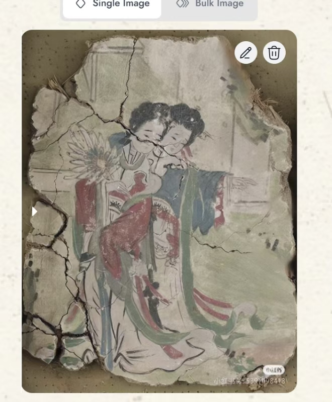 | 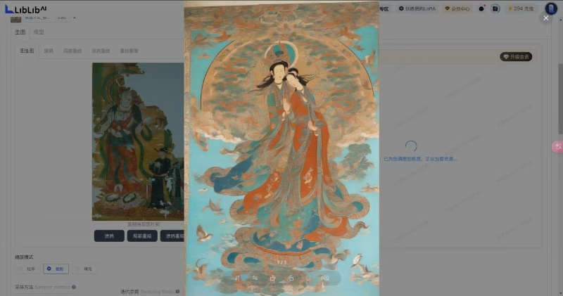 |

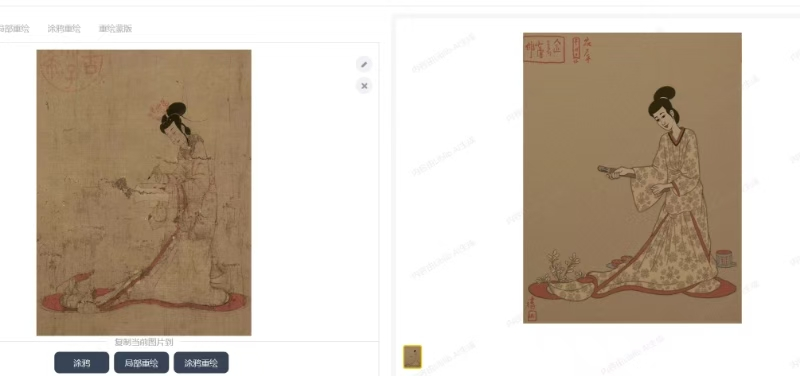

上图展示局部区域从残损输入到候选修复结果的变化，用于说明生成式修复并非一次完成，而是需要结合区域特征进行多轮尝试。

### 工作流与结构约束

通过节点化工作流串联图像加载、结构分析、模型加载、提示词、采样和保存等步骤，并用 ControlNet 的边缘预处理保留人物轮廓、裂缝走向和画面构图。

| 工作流节点 | 工作流细节 |
| --- | --- |
| 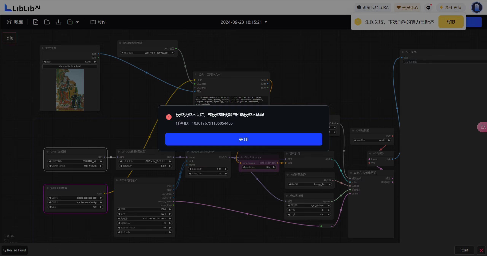 | 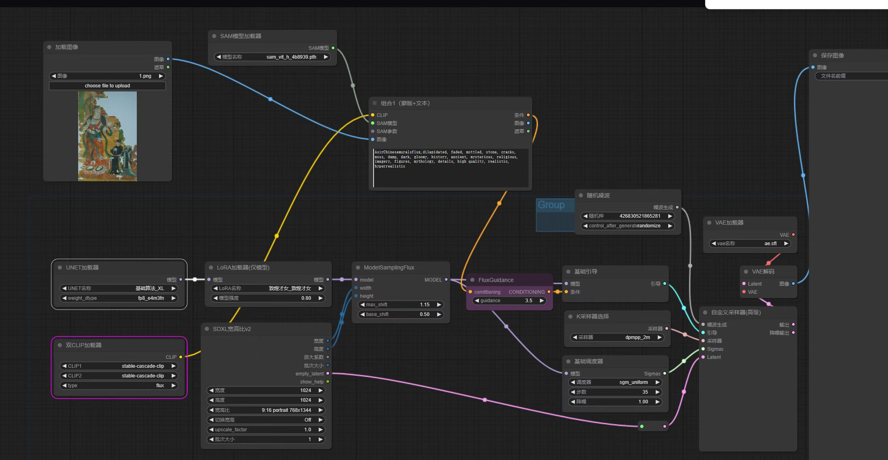 |

### 参数调试记录

实验过程中分别调整采样步数、CFG Scale、Denoising Strength、Control Weight、起始/结束控制步数和 Canny 阈值，比较不同参数对细节补全与风格保持的影响。

| 图生图参数 | ControlNet 边缘预处理 |
| --- | --- |
| 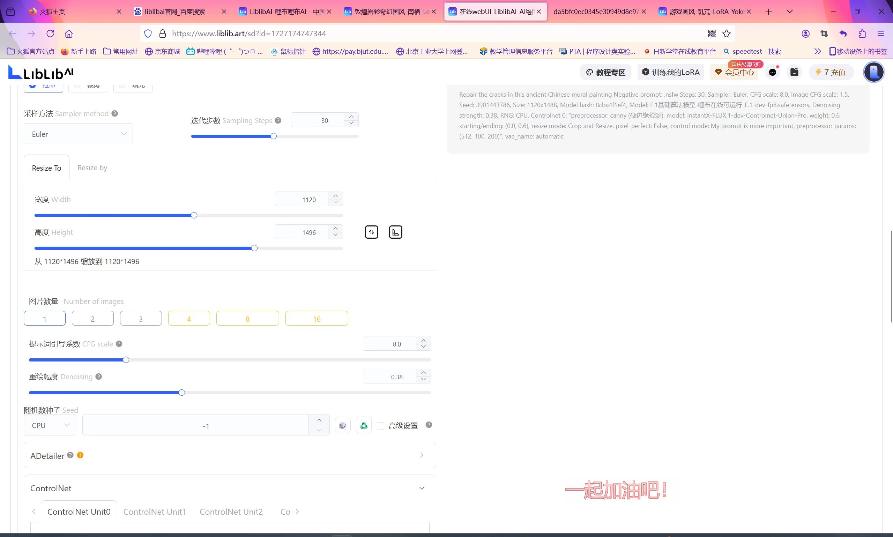 | 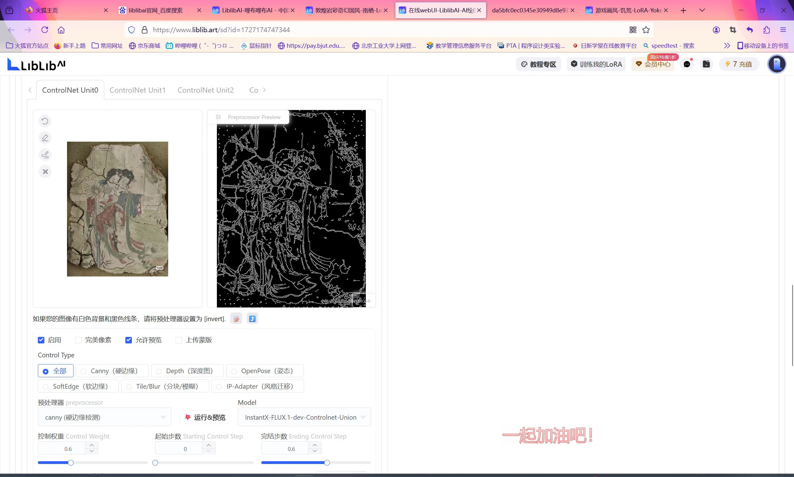 |

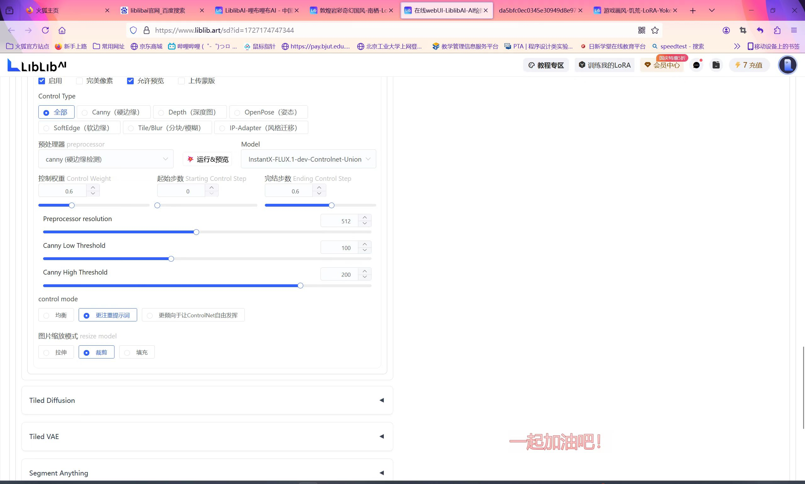

### 多样本实验

除人物壁画外，也对书法和其他古画样本进行尝试，用于观察模型在不同纹理、线条密度和破损形态下的表现。

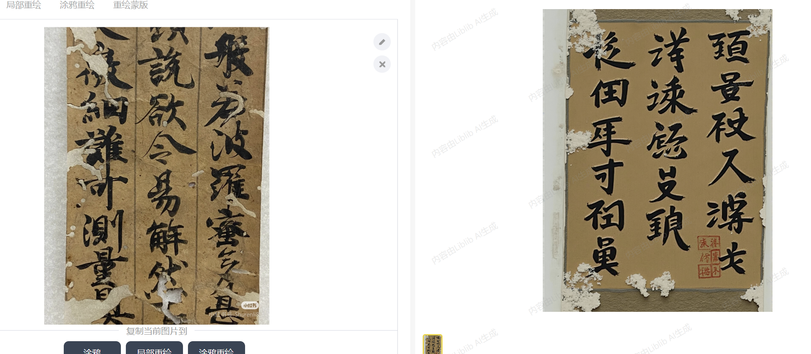

## 修复效果展示

### 示例一：人物壁画

| 修复前 | 修复后 |
| --- | --- |
| 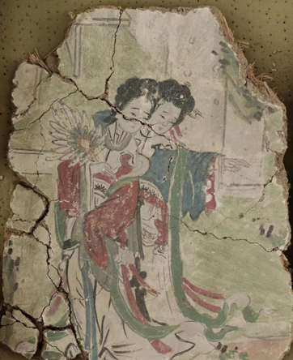 | 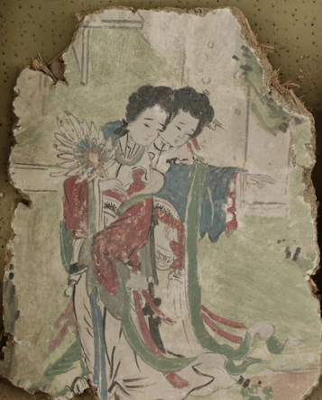 |

该组样例主要处理画面中的大面积裂缝、边缘破损和局部色彩缺失。修复后保留人物主体、服饰配色与花卉位置，画面连续性得到改善。

### 示例二：人物与花木场景

| 修复前 | 修复后 |
| --- | --- |
| 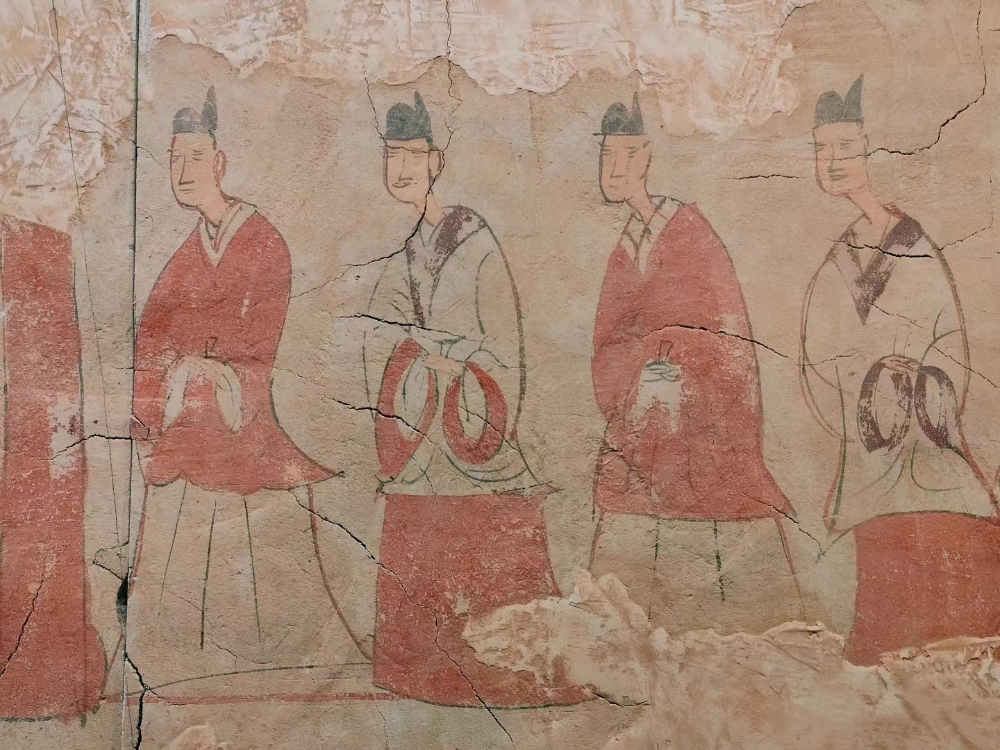 | 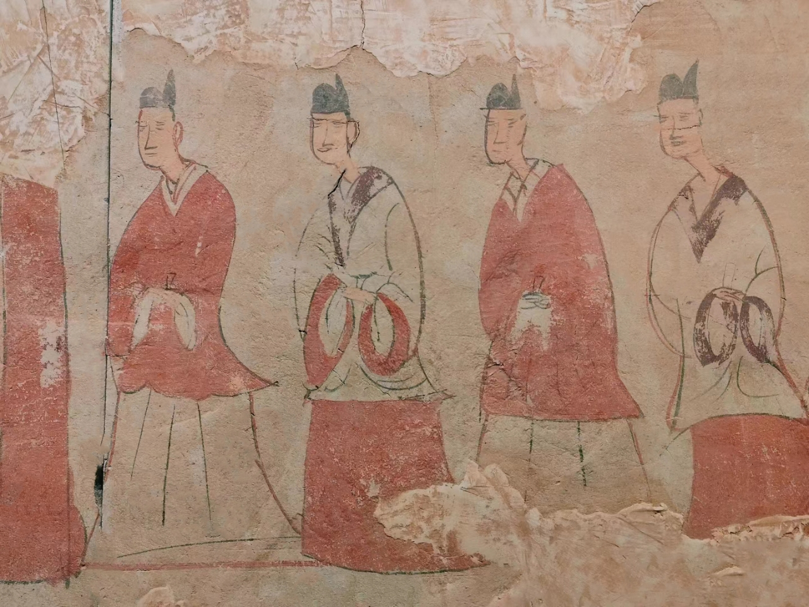 |

该组样例重点观察人物轮廓、花木线条和背景纹理的补全效果。通过结构约束减少主体变形，再结合色彩与纹理调节，使修复结果与原画风格保持一致。

## 工作内容

- 整理和预处理古画图像，分析裂缝、缺损、褪色等问题区域。
- 选择基础模型与 ControlNet 组合，设计适用于不同画面结构的提示词和负向提示词。
- 调整采样器、随机种子、CFG Scale、Denoising Strength 等生成参数，比较不同方案的细节和风格表现。
- 参与模型训练与结果评估，围绕结构保持、色彩协调和纹理连续性筛选输出。
- 汇总修复前后样例，整理技术路线与竞赛展示材料。

## 项目成果

- 获得 **CMIT 竞赛 AIGC 赛道市级三等奖**。
- 形成两组以上可对比的古画修复样例，覆盖裂缝、局部缺损、褪色和纹理断裂等问题。
- 建立从图像预处理、模型与控制条件选择、参数调优到结果评估的完整实验流程。
- 整理出可复查的模型、采样器、随机种子、提示词和 ControlNet 参数记录，便于后续复现实验和继续优化。

## 竞赛展示

项目以“穿越时空的色彩”为题参加 CMIT 竞赛 AIGC 赛道，并获得市级三等奖。仓库仅保留与作品展示直接相关的技术过程和结果图片，竞赛报名表、承诺书及包含个人或团队信息的页面未上传。

## 说明

本仓库用于展示项目思路、技术路线和结果样例，不包含完整训练数据、第三方模型权重或在线平台账号配置。古画修复结果仍需结合文物研究、原始资料和专业人员复核，生成内容不能直接替代文物修复结论。
